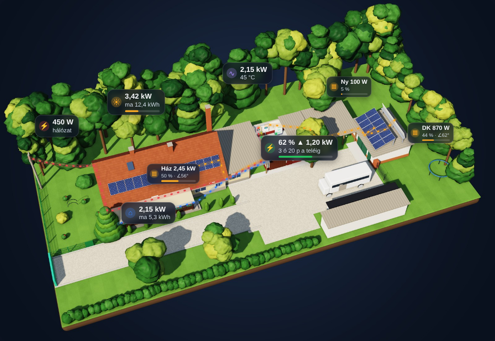
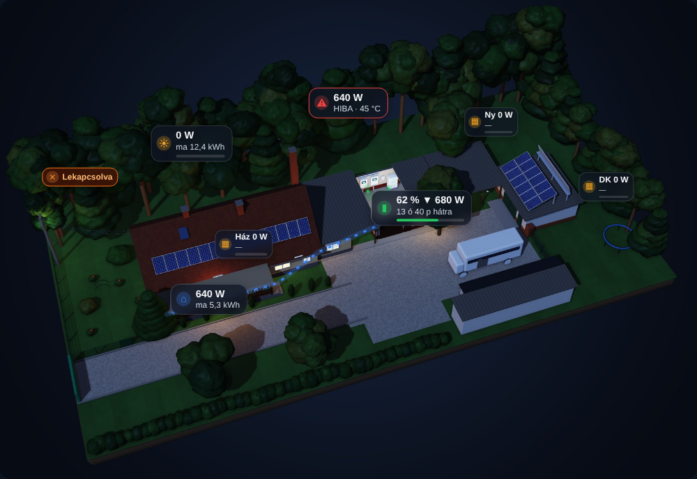

# Deye Ház Card

3D off-grid napelemes ház kártya Home Assistanthoz – Deye párhuzamos inverterek (Solarman integráció),
akkumulátor és bővíthető napelem sztringek, élő, animált energiafolyammal.




## Mit tud
- Valódi 3D renderelt kép a telekről, **nappal / éjjel** automatikusan (`sun.sun`)
- **Animált energiafolyam**: napelem → inverter, akku töltés/merítés, hálózat, fogyasztás – a sebesség a teljesítménnyel arányos
- Buborékok: napelem össz. + mai termelés, **sztringenként W · kihasználtság % · napbeesési szög**, inverter terhelés + hőmérséklet,
  akku SOC + töltés/merítés + hátralévő idő, ház fogyasztás, hálózat (vagy „Lekapcsolva”)
- Riasztás: inverter hibánál piros villogó buborék, 10 % alatti akkunál villogás
- **Koppintás** → felugró panel (Bubble Card `#hash`) vagy bármely útvonal; **nyomva tartás** → entitás előzmény
- A napszöget a kártya maga számolja a `sun.sun` állásából és a sztring dőlés/tájolás adataiból
- Méretezés a kártya szélességéhez (telefonon és tableten is olvasható)

## Telepítés (HACS)
1. HACS → ⋮ → **Egyéni tárolók** → ennek a tárolónak az URL-je, típus: **Irányítópult (Dashboard)**.
2. Keresd: **Deye Ház Card** → Letöltés → böngésző frissítése.

Kézi telepítés: másold a `dist` mappa tartalmát a `/config/www/community/deye-haz-card/` mappába, és vedd fel erőforrásként:
`/local/community/deye-haz-card/deye-haz-card.js` (JavaScript modul).

## Használat
```yaml
type: custom:deye-haz-card
```
Alapértelmezésben a `deye_offgrid` package entitásait használja. Minden felülírható:

```yaml
type: custom:deye-haz-card
night: auto              # auto | always | never
invert_battery: false    # true, ha nálad a + jelenti a töltést
threshold: 20            # W – ez alatt nincs folyam-animáció
entities:
  pv: sensor.deye_pv_teljesitmeny
  pv_today: sensor.deye_termeles_napi
  load: sensor.deye_fogyasztas_teljesitmeny
  load_today: sensor.deye_fogyasztas_napi
  battery_soc: sensor.deye_akku_soc
  battery_power: sensor.deye_akku_teljesitmeny      # + merítés / − töltés
  battery_time: sensor.deye_akku_hatralevo_ido      # perc
  grid_power: sensor.deye_halozat_teljesitmeny
  grid_connected: binary_sensor.fo_inverter_grid
  inverter_temps: [sensor.fo_inverter_temperature, sensor.inverter_2_temperature]
  inverter_faults: [sensor.fo_inverter_device_fault, sensor.inverter_2_device_fault]
strings:                 # bővíthető: új sor = új buborék
  - { name: Ház, entity: sensor.deye_string_1, peak: 4900, tilt: 45, azimuth: 180, top: 50, left: 37 }
  - { name: Ny,  entity: sensor.deye_string_3, peak: 2000, tilt: 70, azimuth: 270, top: 25.5, left: 70.5 }
  - { name: DK,  entity: sensor.deye_string_2, peak: 2000, tilt: 70, azimuth: 120, top: 39, left: 87 }
positions:               # [felülről %, balról %]
  pv: [30, 27.5]
  inverter: [21.5, 50]
  battery: [43.5, 60.5]
  load: [65.5, 27.5]
  grid: [37, 11.5]
tap:                     # '#hash' (Bubble Card pop-up), '/útvonal', 'more-info' vagy 'none'
  pv: "#napelemek"
  strings: "#napelemek"
  inverter: "#inverterek"
  battery: "#akkumulator"
  load: "#inverterek"
  grid: "#halozat"
image_day: /local/sajat_nappal.jpg     # saját kép (opcionális)
image_night: /local/sajat_ejjel.jpg
```

A `azimuth`: 0 = É, 90 = K, 180 = D, 270 = Ny; a `tilt` a dőlésszög (0 = vízszintes).
Napszög: a napsugár és a panel felülete közti szög – **90° = merőleges (ideális)**, 0° = nem éri a nap.

## Licenc
MIT
